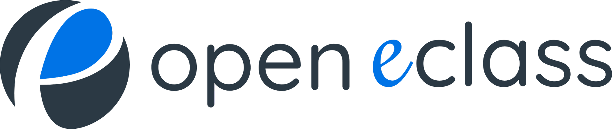
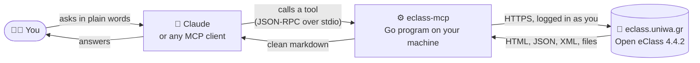
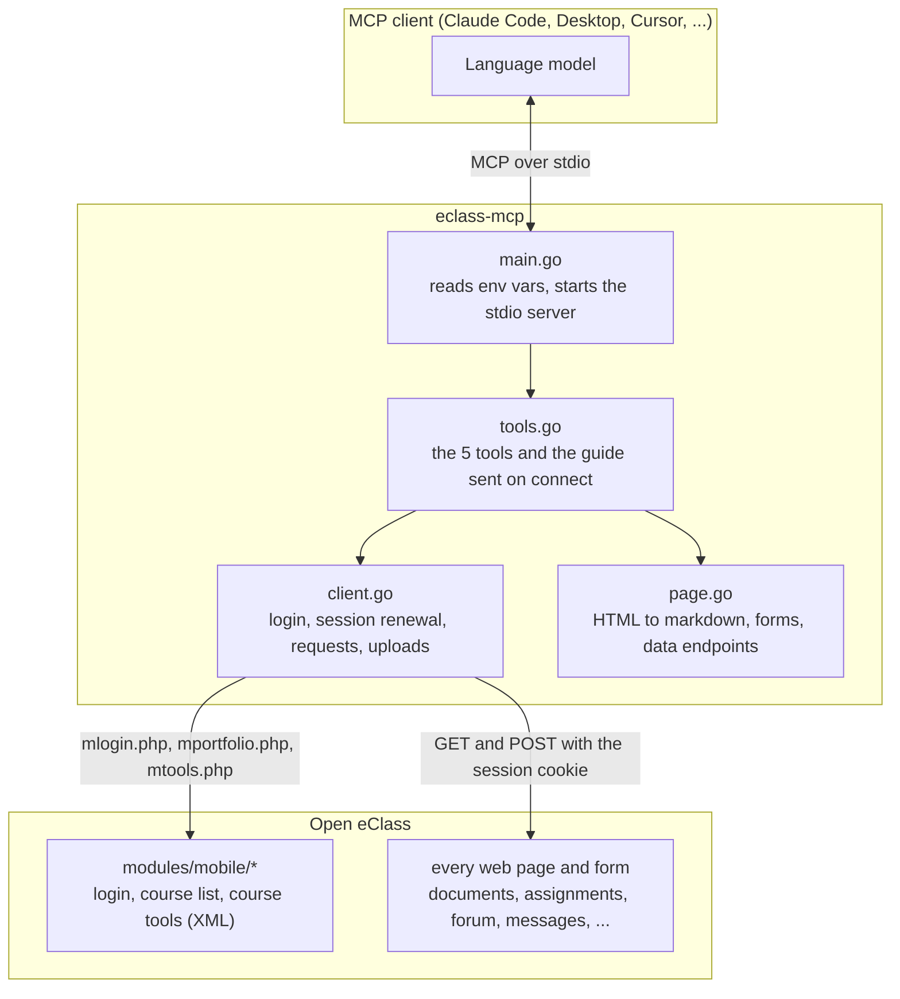
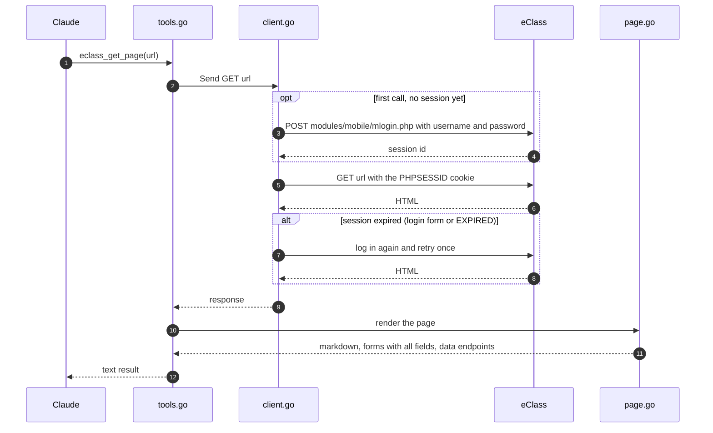

<p align="center">
  
  <br>
  <picture>
    <source media="(prefers-color-scheme: dark)" srcset="docs/images/openeclass-dark.png">
    
  </picture>
</p>

<br>

<p align="center">
  <i>"Simplicity is complicated."</i>
  <br>
  <sub>Rob Pike, co-creator of Go</sub>
</p>

<h1 align="center">eclass-mcp</h1>

<p align="center">
  Talk to your university's eClass from Claude, or from any other AI assistant that speaks MCP.
</p>

<p align="center">
  <a href="https://github.com/uniwa-community/eclass-mcp/actions/workflows/test.yml"></a>
  <a href="https://github.com/uniwa-community/eclass-mcp/actions/workflows/lint.yml"></a>
  
  
  
  <a href="LICENSE"></a>
</p>

---

eclass-mcp is a small server that connects AI assistants to [Open eClass](https://www.openeclass.org/), the learning platform most Greek universities run. Plug it into Claude Code, Claude Desktop, Cursor, VS Code, Codex, Gemini CLI or any other MCP client, and your assistant can read your courses, grab your documents, check deadlines, post in forums and submit assignments for you.

It was built for [eclass.uniwa.gr](https://eclass.uniwa.gr) (University of West Attica) and tested against **Open eClass 4.4.2**, the version that site runs today. It should work with any Open eClass 4.x site that has the mobile API turned on. Most do, because that is what the official eClass app uses.

The Rob Pike quote up top is the idea behind the whole project. eClass has around forty modules, and instead of forty tools there are five, written in under a thousand lines of plain Go, comments included.

## Contents

- [What you can ask it](#what-you-can-ask-it)
- [MCP in plain words](#mcp)
- [Install](#install)
- [Configuration](#configuration)
- [Hooking it up](#hooking-it-up)
- [The tools](#the-tools)
- [Examples](#examples)
- [What's covered](#whats-covered)
- [Safety](#safety)
- [Troubleshooting](#troubleshooting)
- [Development](#development)
- [License](#license) and [Credits](#credits)

## What you can ask it

- "What's new in my courses this week?"
- "Which assignments are due before Friday, and have I submitted them?"
- "Download all the lecture slides from Operating Systems."
- "Summarise the last announcements from my lab course."
- "Upload ~/thesis/report.pdf to assignment 3 of Databases."
- "Reply to the latest forum thread in Networks saying I'll be at the lab."
- "Show me my grades."

## MCP

### What it is

MCP (Model Context Protocol) is a common plug for AI assistants. On its own an assistant like Claude can only talk; it can't log in to your eClass. An MCP server is a small program that runs on your computer and offers the assistant a few **tools**, each with a name, a short description and a list of inputs. When you ask something, the assistant picks a tool, the server does the actual work, and the result goes back to the assistant as text.

Think of the assistant as someone who reads and writes really well but has no hands, and of the MCP server as the hands.



The conversation between the assistant and the server is plain JSON messages over the program's standard input and output (that is what "stdio" means). Your client starts `eclass-mcp` in the background, asks it which tools it has, and calls them whenever it needs to. Nothing runs in the cloud on our side, and your password goes only to your eClass site.

### How this one is built

Five tools sit on top of a small HTTP client that knows how to log in to eClass, and a page renderer that turns eClass HTML into markdown an assistant can read.



And this is what happens during a single tool call, say "open the assignments page":



A few details worth knowing:

- **Login** uses `modules/mobile/mlogin.php`, the same endpoint the official eClass app uses. It returns a PHP session id, which the server then sends as a normal cookie for every web page. eClass flags that session as "mobile", which conveniently strips most of the site's chrome from the HTML.
- **Expired sessions** are spotted automatically (the mobile API answers `EXPIRED`, web pages bounce to the login form). The server logs in again and retries once, so you never see it.
- **JavaScript lists** like announcements and the inbox are loaded by eClass with DataTables. The renderer finds those data URLs in the page scripts, and calling them with `ajax: true` returns the rows as JSON with the HTML inside each cell already turned into markdown.
- **Uploads** that eClass builds with JavaScript (the Uppy widget on assignments) are detected and listed, so the assistant knows the field is called `userfile[]`.
- **Safety net**: the client refuses to send your session to any host other than your eClass site.

Pages are converted with [html-to-markdown](https://github.com/JohannesKaufmann/html-to-markdown) and [goquery](https://github.com/PuerkitoBio/goquery), and the MCP side uses the official [Go SDK](https://github.com/modelcontextprotocol/go-sdk).

## Install

You need Go 1.26 or newer.

```sh
go install github.com/uniwa-community/eclass-mcp@latest
```

That drops an `eclass-mcp` binary in `$(go env GOPATH)/bin` (usually `~/go/bin`). Make sure it is on your `PATH`, or use the full path in the configs below.

Building from a clone works too:

```sh
git clone https://github.com/uniwa-community/eclass-mcp
cd eclass-mcp
go build -o eclass-mcp .
```

## Configuration

Everything is set with environment variables. Your MCP client passes them to the server when it starts it.

| Variable | Required | Default | What it is |
|---|:---:|---|---|
| `ECLASS_USERNAME` | ✅ | | Your eClass username |
| `ECLASS_PASSWORD` | ✅ | | Your eClass password |
| `ECLASS_URL` | | `https://eclass.uniwa.gr` | Your university's eClass address |
| `ECLASS_DOWNLOAD_DIR` | | `~/Downloads/eclass` | Where downloaded files are saved |

Your credentials never leave your machine except to log in to the eClass site itself.

## Hooking it up

### Claude Code

```sh
claude mcp add eclass --scope user \
  -e ECLASS_USERNAME=your_username \
  -e ECLASS_PASSWORD='your_password' \
  -- eclass-mcp
```

`--scope user` makes it available in every project. Run `claude mcp list` to check it connected, or `/mcp` inside a session.

<details>
<summary><b>Claude Desktop</b></summary>

<br>

Open Settings, then Developer, then Edit Config, and add:

```json
{
  "mcpServers": {
    "eclass": {
      "command": "eclass-mcp",
      "env": {
        "ECLASS_USERNAME": "your_username",
        "ECLASS_PASSWORD": "your_password"
      }
    }
  }
}
```

Claude Desktop does not always see your shell `PATH`, so if it can't find the binary use the full path, for example `/home/you/go/bin/eclass-mcp`.

</details>

<details>
<summary><b>Cursor, Windsurf, Gemini CLI</b></summary>

<br>

These use the same `mcpServers` block as Claude Desktop. Put it in:

- Cursor: `~/.cursor/mcp.json`
- Windsurf: `~/.codeium/windsurf/mcp_config.json`
- Gemini CLI: `~/.gemini/settings.json`

</details>

<details>
<summary><b>VS Code (Copilot agent mode)</b></summary>

<br>

Create `.vscode/mcp.json` in a workspace, or run "MCP: Open User Configuration" for a global one. VS Code can prompt for the password so it never sits in a file:

```json
{
  "inputs": [
    { "type": "promptString", "id": "eclass-password", "description": "eClass password", "password": true }
  ],
  "servers": {
    "eclass": {
      "type": "stdio",
      "command": "eclass-mcp",
      "env": {
        "ECLASS_USERNAME": "your_username",
        "ECLASS_PASSWORD": "${input:eclass-password}"
      }
    }
  }
}
```

</details>

<details>
<summary><b>Codex CLI</b></summary>

<br>

In `~/.codex/config.toml`:

```toml
[mcp_servers.eclass]
command = "eclass-mcp"
env = { ECLASS_USERNAME = "your_username", ECLASS_PASSWORD = "your_password" }
```

</details>

<details>
<summary><b>Anything else</b></summary>

<br>

It is a plain stdio MCP server. Run the `eclass-mcp` command with the two environment variables set and you're done.

</details>

## The tools

There are five, on purpose. Every university turns on a different mix of eClass modules, so instead of one tool per screen the server gives the assistant a way to browse eClass the way you would, plus a map of where everything is.

| Tool | What it does |
|---|---|
| 🎓 `eclass_my_courses` | Your name, every course you're enrolled in (with its course code) and your personal tools: messages, calendar, announcements from all courses, notes, profile, usage stats. |
| 🧰 `eclass_course_tools` | Every module enabled in one course, with the link to open it. The list comes from your eClass, so it always matches what you see in the browser. |
| 📄 `eclass_get_page` | Opens any eClass page and turns it into clean markdown. Links come out absolute, icon buttons get their tooltip as text, and every form is listed with all its fields and current values. Lists that load through JavaScript get their data URLs listed, and calling those with `ajax: true` returns the rows as readable JSON. Long pages come in chunks. |
| 📝 `eclass_submit_form` | Fills in and sends a form, including file uploads. That's how assignments get submitted, forum replies posted, messages sent, quizzes answered and so on. |
| 📥 `eclass_download` | Saves a file (a PDF from Documents, an assignment attachment, a zipped folder) to your download folder. |

The server also hands the assistant a short guide when it connects, so it knows to start from your course list, follow links, and send hidden form fields like eClass's CSRF `token`.

## Examples

> [!NOTE]
> These come from real runs against eclass.uniwa.gr on **Open eClass 4.4.2**, trimmed a little, with personal details changed or left out. Another eClass version may word or lay out pages differently, but the flow is the same.

**🗓️ "Do I have any assignments due soon?"**

The assistant calls `eclass_my_courses`, then opens the assignments page of each course with `eclass_get_page`:

> You have one open assignment:
>
> - **Data Mining**, "Εργασία 2026-2027", individual, due Sunday 13 December 2026 at 18:00 (26 days left). Not submitted yet. The brief is attached as `DM_PPS_2026_2027.rar`, want me to download it?

**📚 "Grab the slides for the latest Data Mining unit."**

It opens the course's Documents page, sees the newest folder (`05_ΚΑΝΟΝΕΣ ΣΥΣΧΕΤΙΣΗΣ`, added 26/10) and calls `eclass_download` on the folder's download link:

> Saved the whole folder as a zip to ~/Downloads/eclass/05_ΚΑΝΟΝΕΣ ΣΥΣΧΕΤΙΣΗΣ.zip.

**📣 "What did my teachers announce this month?"**

It opens a course's announcements page and pulls the rows from the page's data endpoint:

> Data Mining posted three announcements: new unit material on Association Rules (26/10, slides and code are in Documents), the Classification unit (25/10), and extra material (25/10).

**✉️ "Any new messages in my eClass inbox?"**

The inbox loads through JavaScript, so the assistant calls its data endpoint with `ajax: true` and then opens the message you care about:

> You have 3 unread messages. The newest is from your Software Quality teacher about the exam schedule, and one from a lab instructor has a PDF attached. Want me to open them or download the attachment?

**📆 "Put all my eClass deadlines in my calendar."**

It fetches `main/personal_calendar/icalendar.php`, which gives every event and deadline across your courses as iCal, and saves it as an `.ics` file you can import anywhere.

**📤 "Submit ~/projects/dm/report.pdf to the Data Mining assignment with the comment 'Final version'."**

It opens the assignment page, finds the upload form and the `userfile[]` upload field, shows you what it is about to send and asks first. Then it calls `eclass_submit_form` with:

```json
{
  "url": "https://eclass.uniwa.gr/modules/work/index.php?course=ICE251",
  "fields": [
    {"name": "id", "value": "54933"},
    {"name": "stud_comments", "value": "Final version"},
    {"name": "work_submit", "value": "true"}
  ],
  "files": [{"name": "userfile[]", "value": "/home/you/projects/dm/report.pdf"}]
}
```

and reads the confirmation page back to you.

**💡 Other things worth trying**

- "Which of my courses have a forum, and what are the newest threads?"
- "Show my grades in every course that has a gradebook."
- "Find the Operating Systems course in the catalogue and enroll me."
- "Reply to my last message from the Networks lab saying I'll be there on Thursday."
- "Summarise everything that changed in my courses since last week."

## What's covered

Because the assistant can open any page and submit any form your account can, it can do anything you can do in the browser. Here is how that maps onto eClass:

| eClass area | What the assistant can do |
|---|---|
| Course list, course home, course description, units | Read everything, follow every link |
| Announcements (per course and "my announcements") | Read, search, and post if you're the teacher |
| Documents | Browse folders, download files and whole folders |
| Assignments | Read the brief and deadline, see your submission and grade, upload a submission |
| Exercises | Read the questions, answer and submit (it asks you before a final submission) |
| Forum | Read threads, reply, start new topics |
| Messages | Read your inbox and sent items, write and reply to messages |
| Agenda, personal calendar | Read events and deadlines, export iCal, add personal events |
| Gradebook, attendance, progress, certificates and badges | Read |
| Polls and questionnaires | Read and answer |
| Links, videos, glossary, e-book, wiki, blog, wall, comments | Read, and write where eClass lets you |
| Learning paths | Read the structure and open the material |
| Groups | See your groups, join or leave where allowed, use group forums and documents |
| Course registration and search | Search the catalogue, enroll and unregister |
| Profile, notes, usage stats | Read and edit |
| Teacher and admin pages | Everything your role allows, through the same pages and forms |

A few things live entirely inside the browser and can't really be driven by an assistant: interactive H5P activities, the live chat window, editing mind maps, drag and drop widgets and joining video calls. Their content and links can still be read.

## Safety

> [!WARNING]
> The assistant acts as you. Anything you could click on eClass, it can click too, and some plain links (delete, unregister, logout) trigger actions on their own.

The server tells the assistant to ask you before anything irreversible, and `eclass_submit_form` is marked as destructive so clients that respect that hint ask for confirmation. If you only want to read, don't approve `eclass_submit_form` calls, or deny the tool in your client's settings.

Keep your password out of shared config files and repos. VS Code's input prompt or your client's secret storage is the nicest option where it exists.

## Troubleshooting

**"wrong username or password"**: double check by logging in on the website. eClass also blocks an IP for a while after several failed attempts, so wait a bit before trying again.

**"the mobile API is disabled on this eClass instance"**: your university turned it off. Ask the eClass admins to enable it in the platform configuration.

**The client says it can't find `eclass-mcp`**: use the absolute path to the binary in your config.

**`go install ...@latest` gives you an older version**: the Go module proxy caches `@latest` for a while. Install a specific commit or tag instead, for example `go install github.com/uniwa-community/eclass-mcp@master`.

**Your university uses single sign-on (CAS, Shibboleth)**: the mobile login needs a username and password that eClass itself can check (local accounts, and usually LDAP ones too). Accounts that can only log in through a browser redirect aren't supported yet.

## Development

You need Go 1.26+ and [golangci-lint](https://golangci-lint.run/) v2:

```sh
go install github.com/golangci/golangci-lint/v2/cmd/golangci-lint@latest
```

Run the checks:

```sh
go test -race ./...
golangci-lint run ./...
```

The code is small and every file has one job:

| File | What's inside |
|---|---|
| `main.go` | Reads the config and starts the stdio server |
| `client.go` | Login, session renewal, requests and uploads |
| `page.go` | HTML to markdown, forms, data endpoints and upload fields |
| `tools.go` | The five tools and turning responses into text |
| `eclass_test.go` | Page rendering and the login retry logic |
| `tools_test.go` | Every tool, through a real MCP client, against a fake eClass |

To poke at it by hand, the [MCP Inspector](https://github.com/modelcontextprotocol/inspector) is handy:

```sh
npx @modelcontextprotocol/inspector -e ECLASS_USERNAME=you -e ECLASS_PASSWORD=secret eclass-mcp
```

### Git hooks

The repo ships two hooks in `.githooks/`. Git doesn't turn them on by itself, so after cloning run this once:

```sh
git config core.hooksPath .githooks
```

From then on:

- **pre-commit** formats the Go files you're committing (gofmt and goimports through `golangci-lint fmt`, or plain gofmt if golangci-lint isn't installed) and stages the result. Heads up: if a file has both staged and unstaged changes, both end up in the commit.
- **pre-push** runs `golangci-lint run` and `go test -race`, and stops the push if either fails.

To skip them for a one-off (a WIP push to your own branch, say) add `--no-verify`. To turn them off again run `git config --unset core.hooksPath`.

### CI

GitHub Actions runs on every push and pull request:

- **Lint** (`.github/workflows/lint.yml`): gofmt check and golangci-lint
- **Test** (`.github/workflows/test.yml`): `go vet`, `go test -race` and a build

## License

GPL-3.0, see [LICENSE](LICENSE). Open eClass itself is free software by [GUnet](https://www.gunet.gr/); this project just talks to it.

## Credits

This project exists because [Open eClass](https://www.openeclass.org/) is open source. It is developed by [GUnet](https://www.gunet.gr/) (the Greek Universities Network) and the source lives at [github.com/gunet/openeclass](https://github.com/gunet/openeclass).

Everything here was built by reading that source, specifically the `Release_4.4.2` tag that eclass.uniwa.gr runs:

- `modules/mobile/` (`mlogin.php`, `mportfolio.php`, `mtools.php`, `minit.php`) for login, the course list and the per course tool list
- `modules/message/`, `modules/announcements/` and `modules/work/` for how the DataTables lists and the Uppy upload widget talk to the server
- `include/init.php` and the Blade layouts for how "mobile" sessions are rendered

Big thanks to the GUnet team and every eClass contributor. This project is not affiliated with or endorsed by GUnet or the University of West Attica.

The Open eClass logo belongs to GUnet and is used here only to credit the project. The Go gopher was designed by [Renée French](https://reneefrench.blogspot.com/) and is licensed under [CC BY 4.0](https://creativecommons.org/licenses/by/4.0/). The quote is from Rob Pike's talk [Simplicity is Complicated](https://www.youtube.com/watch?v=rFejpH_tAHM) at dotGo 2015.
